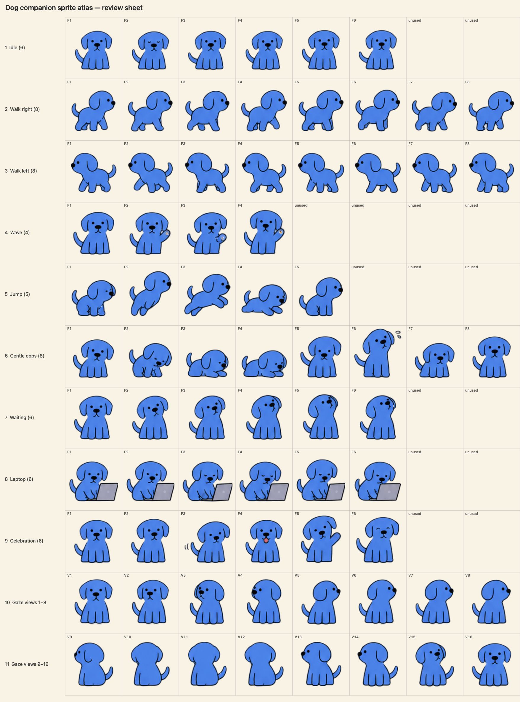

# Pet

Pet is a small, animated dog that lives on your Mac desktop. Hover over him to open a quick ring of apps, drop something on him to keep it in Stash, or tuck him into his cushion when you want a quiet screen.



## Download and install

Pet currently runs on **Apple Silicon Macs with macOS 13 or later**. Download `Pet.dmg` from the [latest release](https://github.com/neeraj-trax/pet-companion-public/releases/latest), open it, and drag **Pet.app** into Applications. Launch Pet from Applications. He appears on the desktop and in the menu bar; there is no Dock icon. Open Pet.app again to show Pet home.

The downloadable app is ad-hoc signed and is **not notarized**. On first launch, macOS may block it: Control-click Pet.app in Applications, choose **Open**, and confirm. This is expected for this locally signed build. If macOS still blocks it, use **Open Anyway** in System Settings → Privacy & Security. The disk image includes the complete app and dog artwork. It does not include icons from other apps; Pet reads those from apps installed on your Mac.

## What Pet does

- **Quick app access:** Hover over Pet or just beside him. The app ring opens immediately. Click an app to launch it. In Pet home, choose your pinned apps or **Recent 6** for the six apps you used most recently before the current one.
- **Stash:** Drop files, images, links, or text on Pet. Open Stash from the ring or menu to drag saved items into another app, including while you are in a full-screen Space. Select items to preview, remove, or undo a removal. Removing a Stash item moves its saved copy to Trash; it does not delete the original.
- **Move him:** Drag Pet to a new spot. Click to poke him; when Follow cursor is off, double-click to switch back to your previous app.
- **Music:** When Spotify or Apple Music is playing, a player chip can appear in the ring for play/pause.
- **A place to rest:** Drag Pet onto the little cushion at the bottom-right edge of the screen. He sleeps there until you click the occupied cushion, even after a relaunch.
- **Room to work:** Pet can shrink and stroll along an edge while you type. He stays available across desktop Spaces and full-screen apps.
- **Follow cursor:** Turn this on from Pet's right-click or menu-bar menu. Double-click or drag Pet to stop following.
- **Personalize:** Open Pet home to change his color, size, and app selection. Changes save automatically.

## Privacy and permissions

Pet keeps settings and app choices on your Mac. Things you drop on him are copied into `~/Library/Application Support/Pet/Stash/`; pinned apps are stored beside that folder, and settings use macOS preferences. The app does not send this data to a server. It does not request microphone access. If you use the Spotify or Apple Music play/pause chip, macOS may ask for Automation permission. A fresh install starts with an empty Stash.

## Build from source

Install Xcode Command Line Tools, then from the repository root run:

```sh
./build-app.sh  # release build, self-test, and build/Pet.app
./build-dmg.sh  # shareable build/Pet.dmg
```

The app is written in Swift and AppKit with no third-party packages. The build uses your Mac's architecture; the published DMG is built for Apple Silicon. To verify a local build:

```sh
.build/release/Pet --selftest
.build/release/Pet --render-poses build/poses.png
.build/release/Pet --render-ring-live build/ring.png
```

`Assets/pet-dog-source.png` is the source sheet. `Tools/prepare-dog-atlas.swift` prepares the transparent runtime atlas and labeled preview. `build-app.sh` bundles the dog atlas and generated app icon. The legacy personal-use sprite is ignored by Git and is never loaded or packaged.

## Limitations

File promises from some apps, including Chrome and Photos, are not yet supported as Stash drops. Multi-monitor edge behavior has had limited testing. The app is not notarized, so installation requires the first-open step above.

## Reuse

This repository is source-available, but no open-source license has been granted. You may download, run, and share the official Pet.dmg for personal use. Please ask before reusing or redistributing the source code or dog artwork separately.
